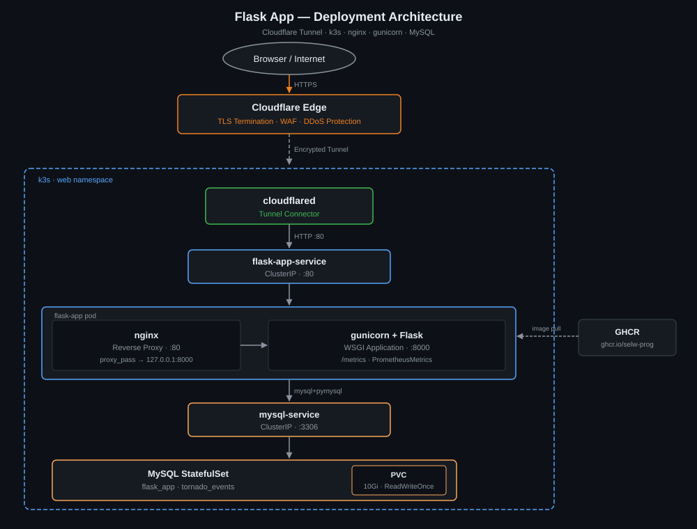

# flask-app

Personal portfolio site built with Flask and deployed on a self-hosted k3s homelab cluster via Cloudflare Tunnel.

Live at [www.seanelwood.me](https://www.seanelwood.me)

---

## Deployment Architecture



---

## Stack

| Layer | Technology |
|---|---|
| Web server | nginx (reverse proxy) |
| Application | Python / Flask / Gunicorn |
| Database | MySQL 8.0 |
| Container registry | GitHub Container Registry (GHCR) |
| Orchestration | k3s (Kubernetes) |
| Ingress | Cloudflare Tunnel |

---

## Project Structure

```
app/
    __init__.py          # App factory, SQLAlchemy binds
    db.py                # SQLAlchemy instance
    models/
        tornado.py       # TornadoEvent ORM model
    routes/
        main.py          # /, /projects
        tornado.py       # /projects/tornado, /projects/tornado/api/events
    templates/           # Jinja2 templates (Bootstrap 5)
    static/              # CSS, JS
scripts/
    import_tornado_events.py   # NOAA storm events CSV importer
    requirements.txt
Dockerfile
requirements.txt
deployment-architecture.svg
```

---

## Projects

### Tornado Events Database
A searchable database of NOAA tornado events across the United States. Filter by state to explore event history by county, EF scale, and year with an interactive Chart.js visualization.

- Data source: [NOAA NCEI Storm Events](https://www.ncei.noaa.gov/pub/data/swdi/stormevents/csvfiles/)
- Import script: `scripts/import_tornado_events.py`

---

## Development

```bash
python3 -m venv .venv
source .venv/bin/activate
pip install -r requirements.txt
flask --app "app:create_app()" run
```

Requires a `.env` file or environment variables for database credentials. See `app/__init__.py` for required keys.

---

## Deployment

GitHub Actions (`.github/workflows/build.yml`) builds, smoke-tests and pushes the image to GHCR on every push to `main`, tagged `sha-<short>` and `latest`. K3s manifests live in the [homelab](https://github.com/selw-prog/homelab) repository and pin the `sha-` tag.

```bash
kubectl -n web set image deployment/flask-app gunicorn=ghcr.io/selw-prog/flask-app:sha-<short>
kubectl -n web rollout status deployment/flask-app
```
